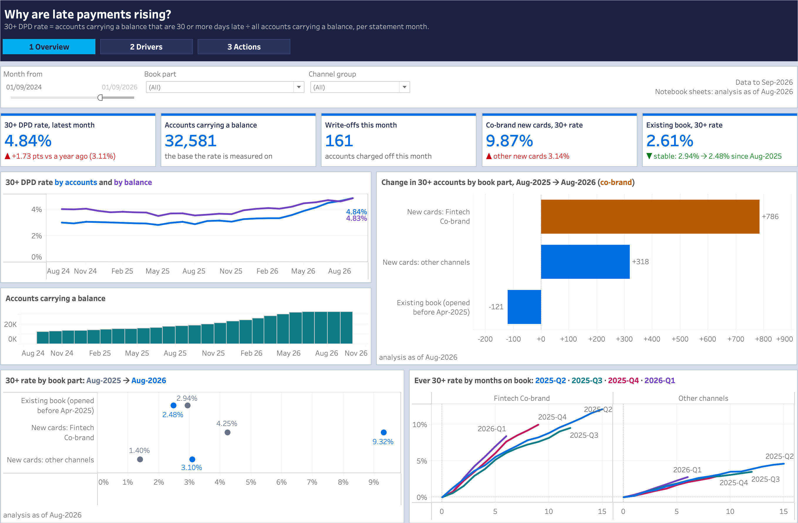
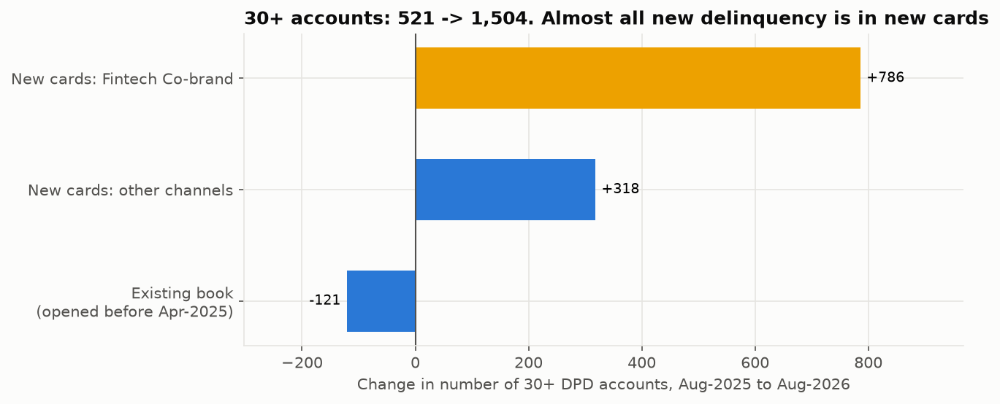
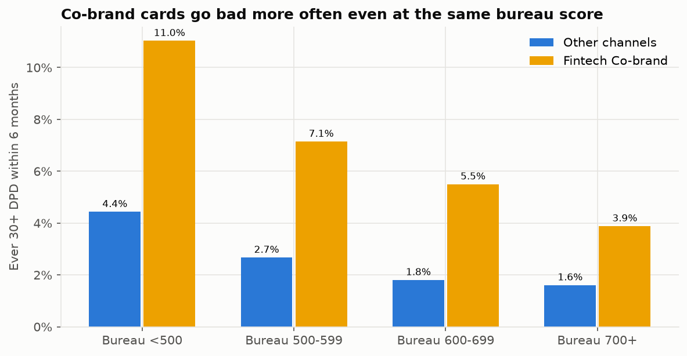
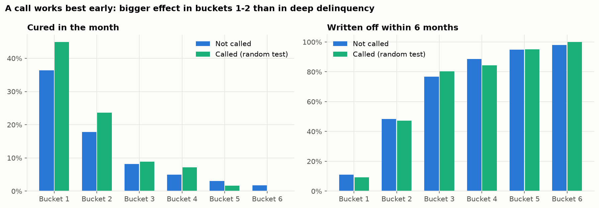
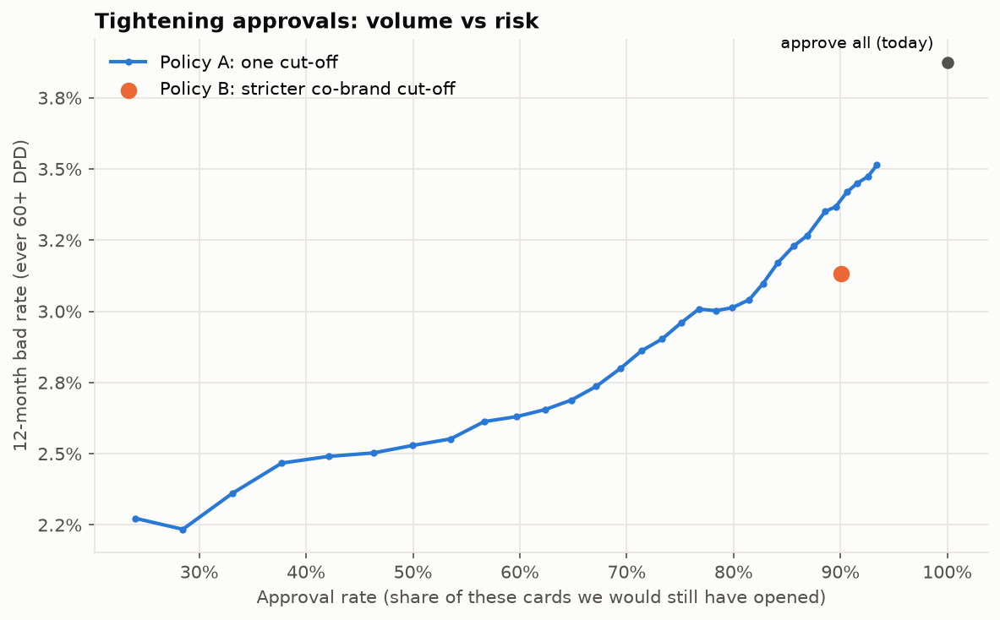
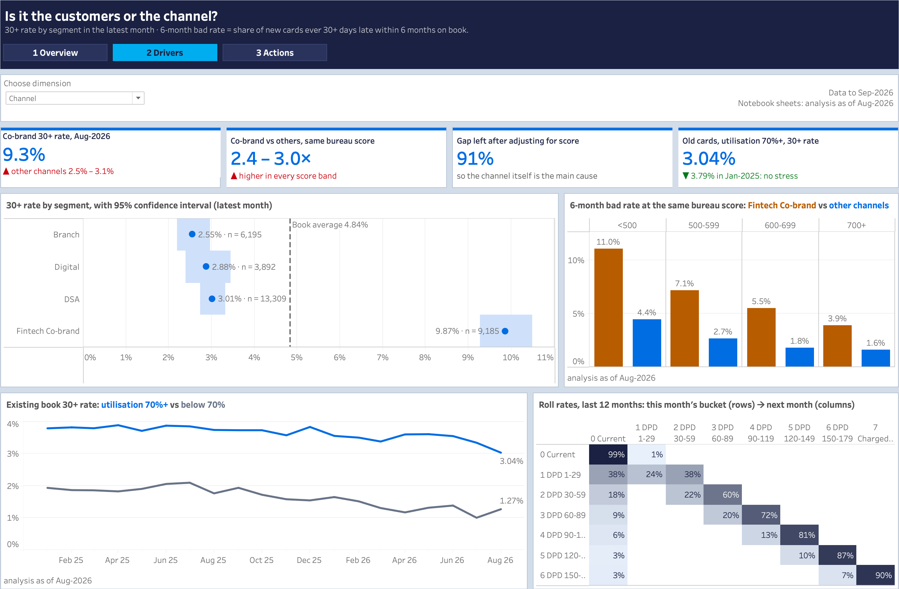
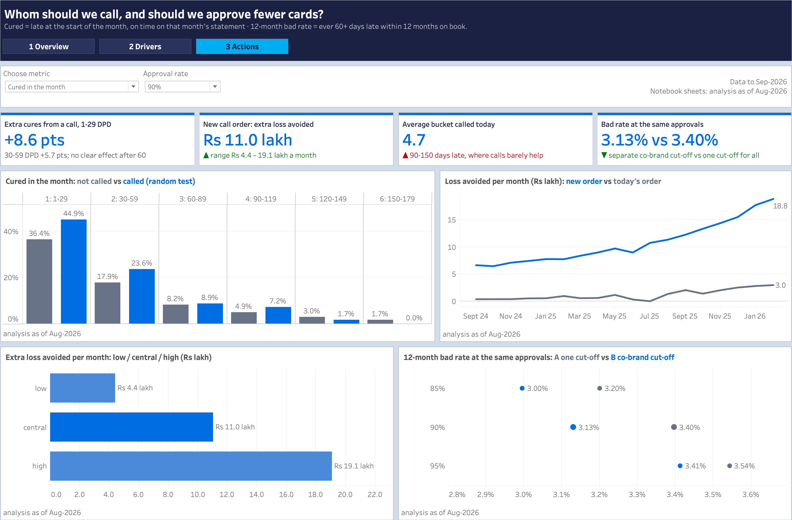
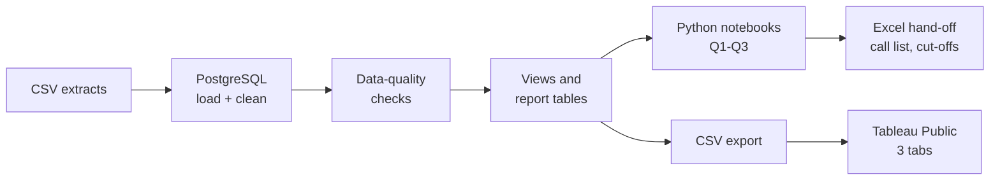

# Credit-Card Risk Analytics: why late payments are rising, and what to do


An end-to-end risk analytics project for the credit-card book of **Velmora Bank**: find out why the 30+ DPD
rate is rising, decide whom Collections should call, and test whether a new approval cut-off would help.

**[View the live dashboard on Tableau Public](https://public.tableau.com/app/profile/vishal.parmar7472/viz/CreditCardRiskAnalytics_17928708240000/1Overview)**
· [Report (PDF)](reports/deck.pdf)
· [Metric definitions](docs/metric_definitions.md)
· [Notebooks](notebooks/)
· [SQL](sql/)

[](https://public.tableau.com/app/profile/vishal.parmar7472/viz/CreditCardRiskAnalytics_17928708240000/1Overview)

## Contents

- [Business problem](#business-problem)
- [Key results](#key-results)
- [What I found](#what-i-found)
- [What I recommend](#what-i-recommend)
- [Dashboard](#dashboard)
- [Data](#data)
- [Approach](#approach)
- [Project structure](#project-structure)
- [How to run](#how-to-run)
- [Limitations](#limitations)
- [Skills used](#skills-used)
- [Contact](#contact)

## Business problem

The share of credit-card accounts that are 30+ days late (**30+ DPD rate**) went up from **2.87% in Aug-2025
to 4.63% in Aug-2026**, and reached **4.84% in Sep-2026**. The Head of Risk asked:

| # | Question | Answered in |
|---|---|---|
| Q1 | Is the rise coming from new cards or from existing customers? | [notebook 02](notebooks/02_why_is_delinquency_rising.py) |
| Q2 | Which customer groups drive it? | [notebook 03](notebooks/03_segment_drivers.py) |
| Q3a | Collections can call only 15% of late accounts. Whom should they call? | [notebook 04](notebooks/04_collections_strategy.py) |
| Q3b | Should we approve fewer cards, or approve them differently? | [notebook 05](notebooks/05_approval_policy.py) |

Before any of this, [notebook 01](notebooks/01_data_quality.py) checks the data.

## Key results

| Metric | Result |
|---|---|
| 30+ DPD rate | 2.87% (Aug-2025) → 4.63% (Aug-2026) → 4.84% (Sep-2026) |
| Extra 30+ accounts, Aug-2025 → Aug-2026 | **+983**, of which **+786** are new Fintech co-brand cards |
| Co-brand vs other channels at the same bureau score | **2.4-3.0x** worse; 91% of the gap is left after adjusting for score |
| Effect of a collections call (random test group) | **+8.6 pts** cure rate at 1-29 days late, **+5.7 pts** at 30-59 days |
| New call order, same team | **Rs 11.0 lakh** a month more loss avoided (range Rs 4.4-19.1 lakh) |
| Separate co-brand cut-off, same 90% approval | Bad rate **3.13%** vs 3.40% with one cut-off for all |

## What I found

**1. The rise comes from new co-brand cards, not from existing customers.**
Of the 983 extra late accounts, +786 are new Fintech co-brand cards (launched Apr-2025) and +318 are other new
cards. The existing book went −121, and its rate fell from 2.94% to 2.48%.



**2. It is the channel, not only the customers it brings.**
In Sep-2026, co-brand cards are 9.9% late (95% CI 9.3-10.5%), against 2.6-3.0% for Branch, Digital and DSA.
The intervals don't overlap. At the *same* bureau score, co-brand cards go bad 2.4-3.0 times as often, and
adjusting for bureau score leaves 91% of the gap.



**3. Collections calls the wrong accounts.**
The bank's random test group works like an A/B test. A call raises the cure rate by +8.6 points at 1-29 days
late and +5.7 points at 30-59 days (both p < 0.01), and makes no clear difference after 60 days. Today's queue
calls the biggest overdue first, which picks accounts that are on average 90-150 days late.



**4. A separate cut-off for co-brand cards lowers the bad rate at the same volume.**
At 90% approval, a separate co-brand cut-off gives a 3.13% bad rate, against 3.40% with one cut-off for all.
The cards it approves that the single cut-off would decline went bad at 5.1%; the cards it declines that the
single cut-off would approve went bad at 9.1%.



## What I recommend

| # | Action | Evidence | Impact (simulated portfolio) |
|---|---|---|---|
| 1 | Call in order of "loss avoided by calling", not by overdue amount | Random test group, 87-month back-test, LGD 78.8% | **Rs 11.0 lakh a month** more loss avoided with the same team (Rs 4.4-19.1 lakh from the 95% CI of the call effect) |
| 2 | Use a separate, higher bureau-score cut-off for co-brand applications | At the same 90% approval: bad rate 3.13% vs 3.40% | 269 bad cards avoided vs 208 with one cut-off, on the 25,471 cards studied |
| 3 | Review the co-brand partner's approval and onboarding process | Co-brand is worse even at the same bureau score | Fixes the root cause, not only the symptoms |

The trade-off table (85%, 90% and 95% approval) and this month's call list go to the Collections and Credit
Policy teams as an Excel hand-off. The full story for the Head of Risk is in the
[report deck](reports/deck.pdf).

## Dashboard

Three tabs on Tableau Public, one per audience. Buttons at the top move between the tabs.

| Tab | For | What it shows |
|---|---|---|
| [1 Overview](https://public.tableau.com/app/profile/vishal.parmar7472/viz/CreditCardRiskAnalytics_17928708240000/1Overview) | Head of Risk | KPI tiles, 30+ DPD rate by accounts and by balance, where the extra late accounts came from, rate by book part, vintage curves. Filters: month, book part, channel group |
| [2 Drivers](https://public.tableau.com/app/profile/vishal.parmar7472/viz/CreditCardRiskAnalytics_17928708240000/2Drivers) | Risk analysts | Segment rates with 95% CIs (choose the dimension), co-brand vs other channels at the same score, roll rates, utilisation in the existing book |
| [3 Actions](https://public.tableau.com/app/profile/vishal.parmar7472/viz/CreditCardRiskAnalytics_17928708240000/3Actions) | Collections, Credit Policy | Call effect by bucket, call-order back-test, value range, approval trade-off with an approval-rate parameter |

| Drivers | Actions |
|---|---|
|  |  |

## Data

This is a personal project on **semi-synthetic data**. Velmora Bank is not a real bank.

- **Real:** card balances, limits, spending and customer profiles come from the
  [Home Credit Default Risk dataset](https://www.kaggle.com/competitions/home-credit-default-risk) on Kaggle.
- **Simulated:** days late, the collections queue, call logs and recoveries. The public data has almost no late
  payments, so these are simulated on top of the real card behaviour.

| Table | Rows |
|---|---|
| customers | 103,136 |
| cards | 103,864 |
| card_statements (monthly, Nov-2018 to Sep-2026) | 3,576,437 |
| collections_queue | 68,402 |
| collections_calls | 20,559 |
| recoveries | 52,297 |

The raw extracts have problems a real bank extract has too. [`sql/02_clean.sql`](sql/02_clean.sql) fixes six
of them:

1. duplicate statements (the same card and month sent twice)
2. 13 different spellings of 4 channel names
3. a dummy employment year (3026) for customers who are not working
4. gender coded as `XNA` for unknown
5. call timestamps in 3 different formats
6. call logs with mixed-case agent ids, blank outcomes and duplicate calls

Data-quality checks ([`src/dq_checks.py`](src/dq_checks.py)) must pass before any number is used. The data files
are not in this repository because of their size; the repo has the code, the charts and the results.

## Approach



| Step | Method |
|---|---|
| Q1: new vs old cards | Book split into existing book / new co-brand / new other cards; change in late accounts by part; vintage curves; roll rates |
| Q2: who drives it | Segment rates with Wilson 95% confidence intervals calculated in SQL; co-brand vs other channels inside bureau-score bands |
| Q3a: whom to call | Random test group as an A/B test (balance check first), two-proportion tests by bucket, LGD from recoveries, back-test of two call orders, low/central/high value from the CI |
| Q3b: approval cut-off | One cut-off vs a separate co-brand cut-off at the same approval rate; swap-set analysis; trade-off table at 85/90/95% |
| Monthly refresh | One command loads the new month, stops if a data check fails, flags a late extract, and re-exports the dashboard files and the call list |

Every metric is defined in [docs/metric_definitions.md](docs/metric_definitions.md): what is counted, out of
what, and where the logic lives.

## Project structure

```
credit-card-risk-analytics/
├── config/settings.yaml          # business inputs: team capacity, approval rates, refresh deadline
├── sql/
│   ├── 01_create_tables.sql      # one table per extract, plus load / check / refresh logs
│   ├── 02_clean.sql              # the six data fixes
│   ├── 03_views.sql              # shared definitions: buckets, utilisation, months on book
│   └── 04_reports.sql            # monthly KPIs, segments with 95% CIs, roll rates, vintages
├── src/
│   ├── load_data.py              # load the history or a new month into PostgreSQL
│   ├── dq_checks.py              # data-quality checks
│   ├── collections_list.py       # this month's call list
│   ├── export.py                 # CSVs for Tableau, Excel hand-off
│   ├── monthly_refresh.py        # the one-command monthly run
│   └── config.py, db.py, style.py
├── notebooks/                    # 01 data quality, 02-05 one per business question
├── reports/
│   ├── deck.pdf                  # final report: findings and recommendations, 11 slides
│   └── figures/                  # charts used in this README
├── dashboards/                   # Tableau workbook and tab screenshots
└── docs/metric_definitions.md
```

## How to run

You need Python 3.12+, [uv](https://docs.astral.sh/uv/) and PostgreSQL. The data files are not in the repo,
so put the six extracts in `data/raw/` first.

```bash
uv sync                                          # install the Python packages
createdb cards                                   # create the PostgreSQL database
cp .env.example .env                             # add your database user name
uv run python -m src.load_data --history         # load data/raw, clean it, build the views and report tables
# notebooks 01-05: run cell by cell in VS Code (they are .py files with # %% cells)
```

Every month, when the new extract lands in `data/landing/<YYYY-MM>/`:

```bash
uv run python -m src.monthly_refresh                   # load, check, export the CSVs for Tableau and the Excel call list
uv run python -m src.monthly_refresh --month 2026-09   # re-run one month, e.g. after a fix
```

Then refresh the extracts in Tableau and publish again.

## Limitations

- The approval cut-offs were chosen and tested on the same cards, and only approved cards have outcomes. They
  should be checked on new applications before use.
- The same-score test adjusts for bureau score only. Co-brand also brings younger customers, so with more
  adjustments the channel's share of the gap would be lower.
- The rupee value assumes the call effect stays the same when many more early-bucket accounts are called, and the
  back-test favours the new order (it is scored on the measure the new order maximises). A live
  champion/challenger test should confirm it.
- The delinquency and collections data are simulated, so the rupee values describe the simulated portfolio.

## Skills used

**SQL:** table design, data cleaning, views, window functions, Wilson confidence intervals ·
**Python:** pandas, statsmodels, matplotlib · **Statistics:** A/B test with a random control group,
two-proportion tests, confidence intervals, vintage and roll-rate analysis · **Risk:** DPD buckets, LGD,
collections strategy, approval cut-offs and swap-sets · **Reporting:** Tableau Public, Excel hand-off,
automated monthly refresh

---

## Contact

**Vishal Parmar** · Data Analyst\
[LinkedIn](https://www.linkedin.com/in/vishalp1726) · [vishalp4607@gmail.com](mailto:vishalp4607@gmail.com)
